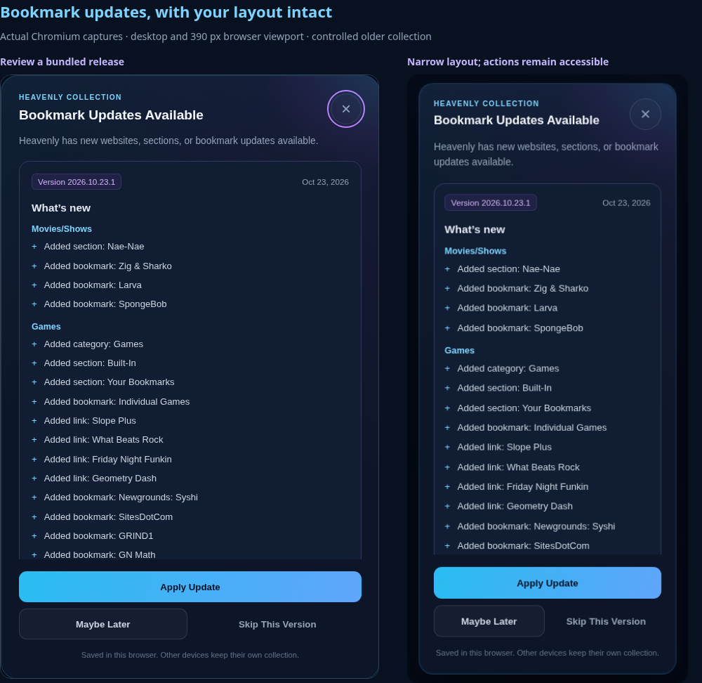
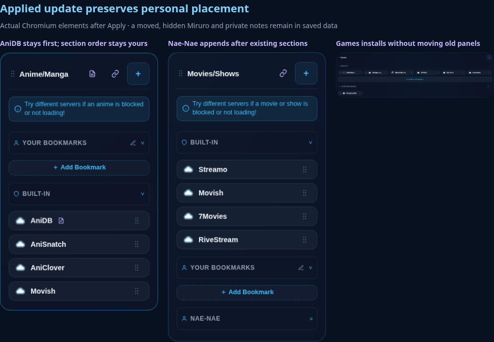
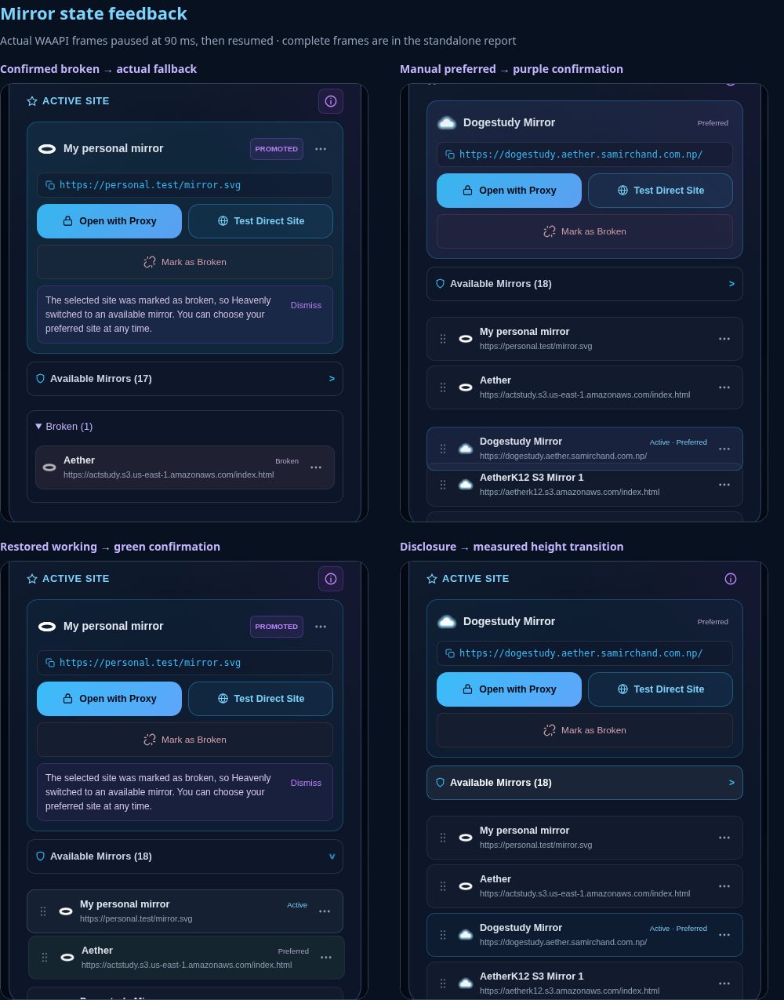

# Reviewed bookmark catalogs and reliable mirror motion

PR #186 continues on `feat/mirror-management-v2`. Nothing is merged automatically.

## Catalog architecture

`public/assets/heavenly-catalog.js` is the single canonical definition and reconciliation engine. The homepage, Settings, and proxy Quick Save widget use it. `app.js` includes the same source in the proxy client bundle. The three duplicated literals and automatic content-merging loops have been removed. The existing navigation helpers still perform known icon-path compatibility repairs and Coolmath's special URL deduplication/append behavior.

The current bundled catalog is the baseline release `2026.10.23.1`, dated October 23, 2026. This implementation does not invent extra websites for a demonstration. Test fixtures model older collections missing real current bookmarks, a category, a subsection and a mirror. Existing complete installations receive no update popup.

The saved `heavenly_bookmarks` document remains the effective, editable collection. Its arrays and numeric ordering, category/section placement, hidden flags, notes, custom entries, icons, launch/Quick Save settings and mirror preferences remain the personal layer. A small `_catalog` envelope adds:

| Field | Purpose |
| --- | --- |
| `schema` | Compatibility format, currently 1 |
| `base` | Last reviewed official records, including skipped changes |
| `accepted` | Official field values last accepted for each stable identity |
| `installed` | Identities previously present, to recognize subsequent deletion intent |
| `tombstones` | Deliberately deleted official identities; later loads do not recreate them |
| `decisions` | Applied/skipped decisions by stable record identity and content-change fingerprint |
| `version`, `lastDecision` | Last reviewed release and user action |
| `conflicts` | Retained custom field values or unavailable installation destinations, shown in Update Center |

Categories and bookmarks have stable IDs. Older ID-less nested links receive a persistent identity in a compatibility migration; exact official URL matches under the same parent adopt the known official ID, while other children receive deterministic legacy IDs with collision handling. Existing URL-based active/preferred/order references migrate with them. No later reorder changes these identities. Sections use category ID plus section ID because historical `builtin`/`user` section IDs repeat. Nested bookmark IDs remain independent of array positions. The catalog identity set, rather than the inconsistent historical `builtIn` flag, identifies shipped records.

### Detection and first adoption

Each release includes a version, human-readable date, summary and complete canonical records. The engine derives the exact added, modified and retired records by comparing the saved official snapshot with the bundle. Change fingerprints contain the stable identity and the before/after official field signatures. A deployment or version-label change with identical content produces no popup. There is no update API, network polling or account service.

A fresh browser installs the current catalog and its baseline in one write. An older collection without `_catalog` adopts a baseline only for official identities already present, without changing their titles, URLs, order or personal fields. Only genuinely absent current records become optional catch-up additions. Historical missing entries cannot reliably be distinguished from deletions made before tombstones existed: they are offered for review, never silently recreated. Skip preserves those absences.

Routine structural compatibility (missing legacy section IDs and known shipped icon paths) is separate from optional catalog content. It still runs after Skip. This release adds no security-critical catalog migration and does not classify ordinary additions or URL changes as mandatory.

### Applying and positioning

Apply rereads and validates the collection, verifies the reviewed change fingerprint, builds a clone, and commits the collection and its catalog decision with one `localStorage.setItem`. Quota/access/validation failure leaves the prior stored document intact and displays an error. Planning does not mutate the input. Reapplying has no duplicate or ordering effect.

Existing array order and numeric positions are retained. Saved category/section placement is treated as personal, including a built-in moved elsewhere. New root bookmarks append with an order greater than all existing entries in their target section. Coolmath retains its historical category-wide append and duplicate-URL exception. New mirrors and nested links append to their existing parent; saved mirror priority remains authoritative. New sections append after existing sections, including Your Bookmarks and custom sections. New categories append to their intended column without altering existing columns or order values.

If an original section no longer exists, a new bookmark uses the category's existing Your Bookmarks section or first surviving section. A deliberately removed category/folder is not recreated implicitly; affected additions remain uninstalled and the Update Center explains why. A genuinely new child in a previously skipped container discloses the minimal parent dependency in the review; other skipped siblings remain absent.

Official title, URL, icon and type changes use the previously accepted official values for a three-way comparison. Unchanged fields can advance; supported personal field changes stay intact and produce a readable conflict notice. Notes, hidden flags, order, placement, launch/Quick Save settings, custom children and mirror selections are never replaced by defaults.

A retired official record is retained with `catalogRetired`, including its notes and user-owned descendants. Retirement does not imply a health check or automatically invalidate an active/preferred destination. The release review explicitly says retired links are kept. Users can hide them using existing controls. No destructive descendant migration is required.

Official URL updates retain previous URLs on the stable record solely to preserve existing broken-link reports. Mirror resolution checks those aliases. Mark Working clears the matching current and prior URL markers. SVG, image and CDN destinations retain the same eligibility rules; catalog membership does not prove a link works.

### Skip, Later and future releases

Skip records the exact changes and advances the reviewed snapshot without changing bookmarks or categories. All readers use this decision, so a homepage load, Settings visit or proxy widget cannot bypass it. Later releases compare actual records: unrelated additions are offered, unchanged skipped additions stay skipped, and a skipped entry can be offered again if its official content meaningfully changes. The accepted snapshot remains separate so a later field update can still recognize personal edits.

Maybe Later, Close, Escape and backdrop dismissal apply nothing and record no permanent skip. A content fingerprint in session storage prevents the same automatic interruption during that browsing session, including reloads. Settings → Bookmark Updates always permits manual review. A small dot on Settings signals pending changes. Automatic review waits for loading, the decoy and other dialogs; it stops retrying after 30 seconds rather than interrupting indefinitely. Pending changes remain accessible manually.

The dialog has a focus loop, focus restoration, keyboard-scrollable details, semantic headings/lists, 44 px controls, error feedback, short entry/exit transitions and reduced-motion behavior. Each browser/device has its own decisions and collection; the UI makes no syncing claim.

### Backups and imports

Private exports now include all selected built-ins because they carry personal layout and mirror data. Complete exports include `_catalog`, a complete-collection marker and broken-link markers; notes/custom mirrors remain included. Public share payloads still omit private catalog/preferences metadata.

A full overwrite import restores its catalog snapshot and decisions. Pre-version backups safely reconstruct a baseline from the actual imported identities. Selective merges retain local review state and honor imported skips only when they match the exact locally pending fingerprint and bundled record; a version label alone cannot suppress future changes. Settings-only imports do not replace catalog decisions. Checkbox selection now respects individually unchecked bookmarks. Unreadable stored collections are left untouched; export can produce a recovery copy containing the original raw value.

Catalog Apply is one atomic document write. Legacy app settings and the separate broken-link map remain separate storage keys; a whole settings-plus-bookmarks import is not a cross-key transaction. No cross-device account sync is added.

## Motion investigation and changes

Two causes were reproduced on baseline `ae29d2c`, not inferred from still images:

1. Mirror state actions immediately reconstructed their rows and created no state-change animations. The reference browser harness records zero mirror-row WAAPI transitions after confirmed broken state.
2. Dialog cleanup ran after `duration + 40 ms`, independent of the browser animation clock. Pausing a closing animation reproduced the dialog being removed before the animation completed. This can cut motion short during delayed rendering.

The shared motion helper uses measured start/end heights, explicit frames, stable owner nodes for normal accordions/Show More, cancellation ownership, animation promises/events, and a 1.2-second stalled-renderer watchdog. Rapid reversals cancel old ownership without running stale completions. External cancellation and document hiding complete logical state, and reduced motion or missing WAAPI completes immediately. Dialog cleanup follows animation completion with a watchdog rather than the old short deadline. Firefox's asynchronous cancellation dispatch is covered through the animation promise as well as events.

Mirror action changes persist immediately, then capture/replay a 240 ms transition in the newly rendered destination. Existing menu closures capture item state, so retaining the entire old renderer would introduce stale action closures; reconstruction is kept for these structural mutations. It now explicitly retains notes drafts, disclosure state, modal and inner-list scroll positions, and logical focus. Old motion/menu ownership is cleaned up before replacement. Normal disclosure changes and mirror reorder operations retain connected rows. A render token prevents an earlier opening frame from stealing focus after a newer render.

- **Confirmed broken:** restrained red destination feedback, opening its Broken group; actual fallback receives cyan active-card feedback.
- **Actual promotion:** event-only PROMOTED remains seven seconds, with the existing first-use approximately eighteen-second explanation and pause behavior. Opening a dialog that actually resolves a fallback also highlights its active card.
- **Preferred:** purple row/card confirmation, updated indicator and screen-reader status; it clears promotion feedback and does not invent a fallback event.
- **Working:** restrained green restoration into Available Mirrors; saved priority, active and preferred choices remain unchanged.

State feedback never precedes active-site broken confirmation. Persistence failure produces an error rather than successful motion. Status text is visually clipped and cannot shift the centered modal.

Existing pointer capture, drag cancellation, desktop dual external menus, compact density, touch/pen behavior and reduced-motion handling remain covered. No new drag or animation framework was introduced.

## Verification and evidence

- `npm test`: **461 passing**, including **34 focused catalog tests**.
- New catalog/motion browser suite: **21 groups in each of Chromium, Firefox and WebKit** (63 total). Settings release details include a real Chromium emulated touch-scroll interaction and keyboard scrolling across all three engines.
- Chromium regressions: **68 groups** across final UX (17), Mirror V2 (9), notes/backups (6), mirror ordering/touch/pen (7), bookmark experience/Quick Save (7), UI recovery (14) and bookmark follow-up (8).
- Baseline browser reproduction confirms silent legacy additions, zero mirror state WAAPI animations and premature paused-dialog cleanup.
- The standalone before/after report contains **29 embedded captures**; its browser check verifies every thumbnail decodes, every original pixel view opens, and desktop/narrow dismissal works.
- Changed inline/shared scripts parse; whitespace checks pass. No production dependency is added.

Vercel deployment status and the authenticated live-preview check are recorded in [PR #186](https://github.com/zryr/Heavenly-Node/pull/186). Browser destinations/icons are controlled fixtures; successful UI interaction is not an endpoint-health claim. Chromium, Firefox and WebKit are browser-engine tests, not physical Chromebook/iPad testing. Viewports include desktop, narrow mobile and the existing Chromebook/iPad-sized regression cases.

`test/browser/capture_catalog_reference.cjs` runs the actual detached baseline checkout. `test/browser/catalog_updates.cjs` uses the bundled catalog with representative older local collections and exercises real Apply/Skip/Later/Close, Settings, file downloads/imports and mirror actions. Motion frame captures pause the actual running WAAPI animation at 90 ms, then resume it; final frames wait for completion. The report embeds full PNG data and opens original pixels, avoiding broken relative image links.

The standalone report is delivered with the workspace artifacts. Small representative comparisons are also committed below for review on GitHub.

## Shipping another catalog release

1. Edit only the canonical definitions in `public/assets/heavenly-catalog.js`. Keep IDs stable across title/URL changes; use new IDs only for genuinely new identities. Update the release version/date/summary for meaningful official content changes.
2. Do not add another automatic merge loop in a reader. The content diff supplies stable change IDs and human-readable review bullets automatically, including removals and nested additions.
3. Keep compatibility repairs narrowly scoped and independently classified; never use that path to bypass an optional skip.
4. Run catalog unit fixtures and browser review/backup/mirror flows. Include customized placements, hidden entries and skipped versions when reviewing a release.
5. Deploy the bundle normally. Existing browsers discover the bundled changes locally; no persistent service is needed.
