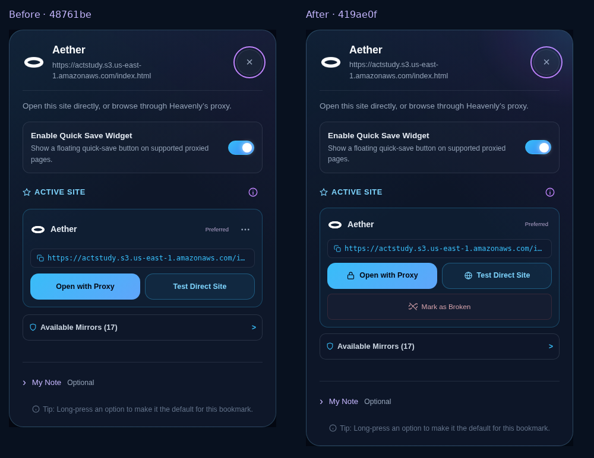
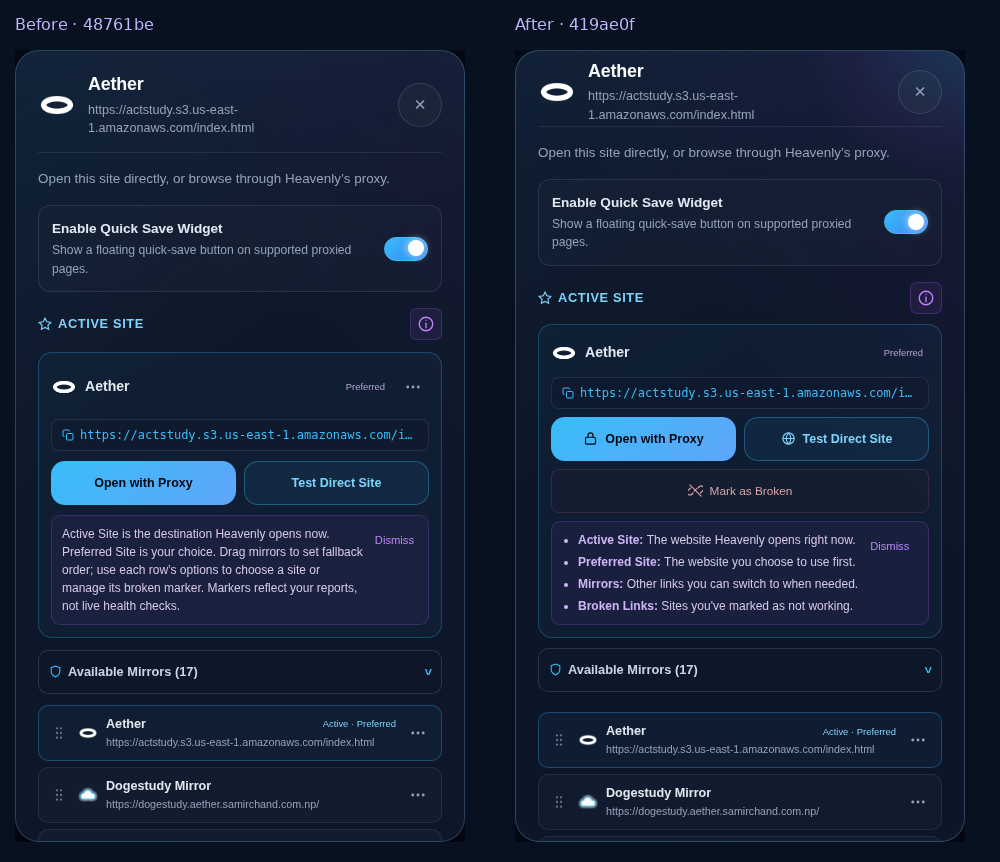
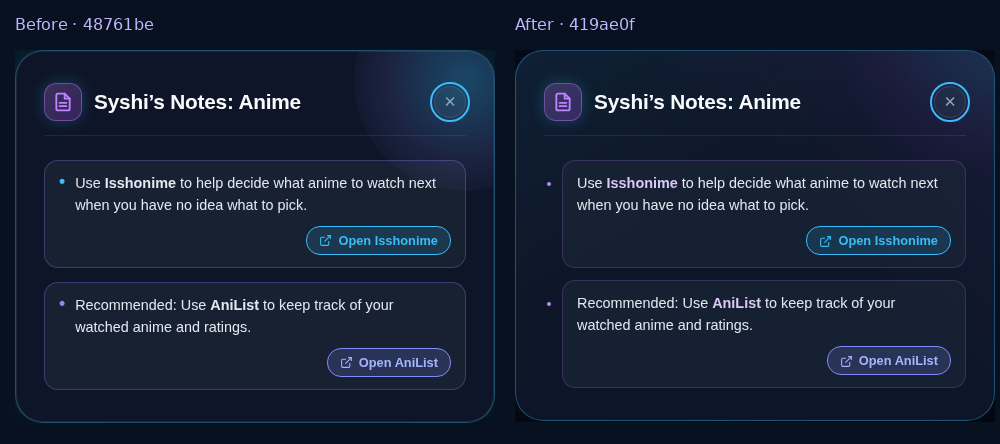
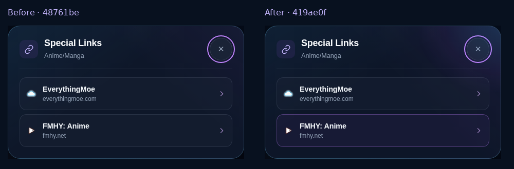

# Final UX refinement for PR #186

This continues `feat/mirror-management-v2`. The implementation is commit `419ae0f`; comparisons use the preceding PR head, `48761be`. Earlier density and placement recovery remains documented in [mirror-ui-recovery.md](mirror-ui-recovery.md).

## Drag freeze and resulting behavior

A capturing `dragstart` listener canceled body-origin native drags but allowed the event to reach the card's handler. That handler still dimmed the source and created a preview. A canceled native start supplies no subsequent `dragend`, leaving the preview and source stuck. The same actual Chromium interaction reproduced one leftover preview and one dimmed source for both bookmark and category bodies at `48761be`; the implementation leaves zero of either after release.

Mouse movement now starts native dragging from a bookmark body, category title/header or bare category surface. Interactive controls retain their own actions. Movement beyond the small threshold cancels a pending body hold; stationary long presses and ordinary clicks remain available. Touch bodies retain native scrolling and their existing long-press action; touch grips retain deliberate hold-to-drag, and pen grips retain precise pointer activation.

Rejected starts stop before source handlers. Escape, blur, hidden documents, invalid release and rerender interruptions clear source dimming, placement, preview and gesture ownership. Canceled drops cannot commit, and compatibility clicks after interruption cannot accidentally launch a bookmark. A fresh click remains usable. Shared previews gain restrained lift/depth while preserving immediate tracking, neighbor displacement, precise placement and release settling. No drag library or production dependency was added.

## Mirror controls and motion

- Desktop and tablet menus group icon commands beside a left arrow rail. Narrow layouts use one menu with a bottom arrow row. The Popover API escapes the list's clipping boundary; an owned portal provides the fallback. Outside interaction, Escape, keyboard navigation, focus restoration, menu exclusivity, scrolling and cleanup are covered.
- The active card keeps its copyable URL pill and launch buttons. Redundant Copy/Mark Broken menu entries are removed; an empty options menu is hidden. A full-width **Mark as Broken** action below the launches opens an inline **Confirm broken / Cancel** prompt. First activation writes nothing. Cancel, outside interaction, Escape and six-second expiry dismiss it. Explicit confirmation updates the marker and resolves fallback through the existing mirror state.
- General Info is a four-item semantic list explaining Active Site, Preferred Site, Mirrors and Broken Links. Genuine promotion retains its separate reason and seven/eighteen-second feedback. Hover styling is limited to fine pointers so repeated touch taps clear the expanded highlight; keyboard focus remains visible.
- Available Mirrors animates height for 210 ms while retaining its DOM. Closing immediately makes its contents inert; rapid reversal cancels stale completion. Dialogs share a navy layered surface, 190 ms entrance and 170 ms exit. Exiting dialogs are inert, rapid reopening is safe, and page scrolling unlocks after closing. Reduced motion skips these animations.
- Syshi's shipped Anime/OP notes use semantic bullet cards, calmer spacing and restrained purple markers/emphasis. Distrosea informational headings and labels use purple while launch actions remain cyan. Instructions, links and private-note data are preserved.

## Actual image comparisons

These repository images have ordinary relative paths and render directly on GitHub. Click an image to view its file.

[](assets/final-ux/active-site.png)

[](assets/final-ux/info.png)

[](assets/final-ux/anime-notes.png)

[](assets/final-ux/special-links.png)

The separately delivered **comparison.html** is self-contained: all **28 actual PNG captures** are embedded. It has no image-folder dependency. Every image decoded and opened at its original pixel width in Chromium; the full-resolution viewer and dismissal were also checked at 390 px. It labels revision, browser and viewport, distinguishes the new confirmation state, and includes an actual WebKit capture at an iPad-sized viewport. The report was served over loopback HTTP for verification; the managed browser blocks local `file://` navigation.

The portable report builder takes a JSON manifest with `title`, `description` and `sections`. Each section supplies `title`, `description` and `captures`; each capture supplies `path` (relative to the manifest), `label`, `browser`, `viewport`, `revision` and optional `simulated`. PNG bytes are embedded, and captions are escaped.

```sh
node scripts/build-ui-comparison.cjs manifest.json comparison.html
node test/browser/ui_comparison_report.cjs /absolute/path/to/comparison.html
```

## Verification completed for this refinement

`npm test`: **426 passing**. Inline scripts, the new dialog helper and browser/report scripts parse; `git diff --check` passes.

| Browser suite | Chromium | Firefox | WebKit |
| --- | ---: | ---: | ---: |
| Final UX refinement | 10 | 10 | 10 |
| UI recovery | 14 | — | — |
| Mirror management V2, including real feedback timers and Return Home | 9 | — | — |
| Mirror ordering / legacy URLs / emulated touch and pen | 7 | — | — |
| Bookmark management | 13 | — | — |
| Gesture conflicts | 8 | — | — |
| Adaptive dragging | 7 | — | — |
| Bookmark notes / backup | 6 | — | — |
| Bookmark follow-up / sharing | 8 | — | — |
| Bookmark experience | 7 | — | — |
| Quick Settings customization | 23 | — | — |
| Navigation / history | 15 | — | — |
| Standalone screenshot report | 2 | — | — |

That is **149 browser check groups**, including the report's two checks. The table describes this refinement's completed runs; it does not add historical passes to the count. The new suite exercises actual body dragging and persistence, rejected controls, interrupted gestures, rapid repeat interactions, menu clipping and fallback, confirmation storage safety, Info tapping, retained accordion nodes, exiting/reopened dialogs and reduced motion. Existing regression suites cover grid/empty-subsection placement, mirror state, exact URLs, retained drafts, notes/backups, long presses and navigation.

```sh
node test/browser/final_ux_refinement.cjs
HEAVENLY_BROWSER=firefox node test/browser/final_ux_refinement.cjs
HEAVENLY_BROWSER=webkit node test/browser/final_ux_refinement.cjs
```

Playwright and each browser engine must be available in the development environment. `HEAVENLY_BROWSER_EXECUTABLE` can select a WebKit launcher when system libraries require one. The existing bookmark management suite uses a separately started app through `HEAVENLY_BASE_URL`.

Rendered/reviewed viewports: desktop 1366 × 900, Chromebook-sized 1366 × 768, iPad-sized 820 × 1180 and narrow 390 × 844. These are simulated viewports and inputs, not physical Chromebook, iPad Safari or pen-device tests. Controlled external destinations/icons establish UI behavior, not endpoint health. Return Home remains subject to browser focus/opener policy. No live destination probing or RiveStream investigation was performed.
