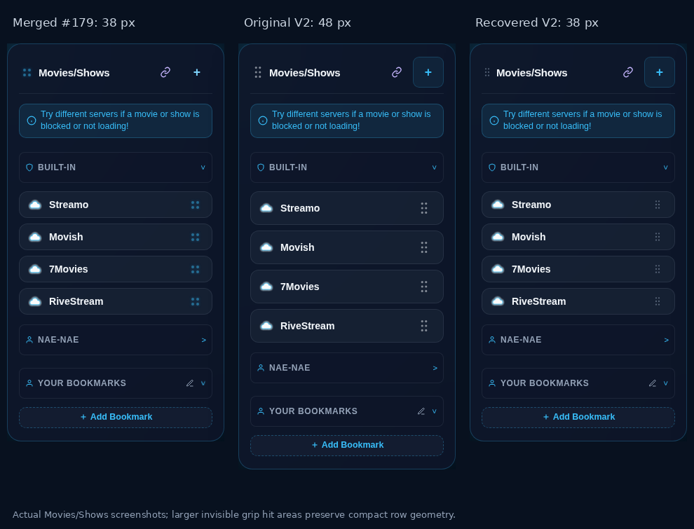
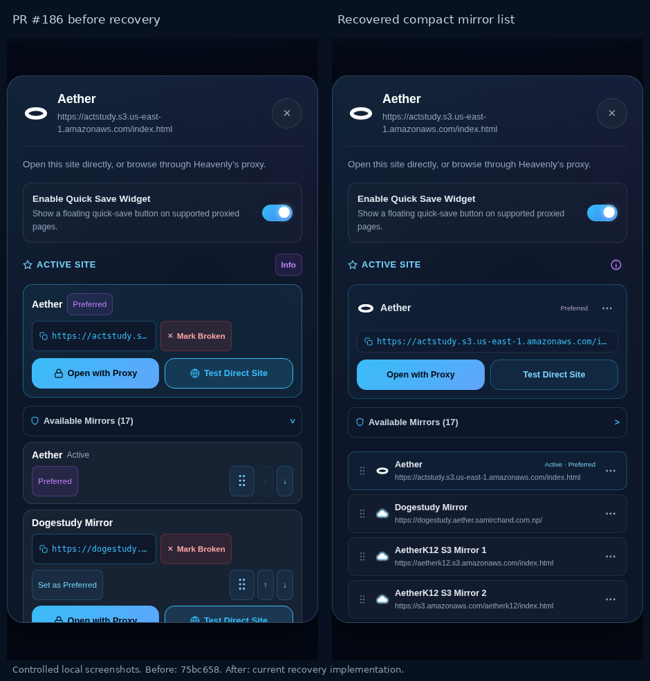

# Mirror UI recovery for PR #186

For the subsequent body-drag freeze fix, responsive menus, confirmation, dialog motion and repaired screenshot delivery, see [Final UX refinement](final-ux-refinement.md). The measurements and test counts below describe the earlier recovery revision.

The original V2 renderer repeated full action cards for each destination, and the six-dot grip's padding increased bookmark row height. Functional placement was reduced to a detached line, while mirror mouse dragging used a native handle image. The Info control reused a fallback explanation even when no fallback had occurred.

## Measured compactness

Measurements and screenshots use local catalog fixtures at 1366 × 900. Before means PR #186 commit `75bc658`; the earlier reference is merged #179 commit `ead7eff`. External requests are intercepted, so favicon placeholders and destination responses do not establish live endpoint health.

| Element | Merged #179 | Original V2 | Recovered V2 |
| --- | --- | --- | --- |
| Movies/Shows and Anime/Manga bookmark row | 38 px | 48 px | 38 px |
| Ordinary available mirror row | — | 194 px | 56 px |
| Active destination's ordering row | — | 90 px | 56 px |

Small visible grips retain larger invisible hit regions. Available destinations live in a bounded scroll area, with a single active launch card and compact identity/status rows. Each row's options disclose preference, Direct/Proxy, Copy, broken status, movement and custom deletion. Add Custom Mirror is collapsed until needed. Keyboard opening, Escape, focus restoration, outside dismissal and exclusive expansion are verified.





## Dragging and selection

Mirror grips use the same pointer controller for mouse, touch and pen. Pickup passes the destination's own name/icon into `HeavenlyDrag`, dims the source and opens a restrained purple insertion space as neighbors shift. Tracking uses animation frames without movement easing; release reorders existing row nodes with FLIP motion and a brief settle. Keyboard arrows and menu movement share the same storage helper. Inner edge scrolling, interruption, pending pickup cleanup and reduced motion are covered.

Bookmarks and categories retain the V2 grid/section/scroll resolver. Shared geometry removes insertion translations from measurements; a pointer inside a tall category takes priority over a short neighboring category. Stable native hit targets accept the gaps exposed by moving neighbors. Preview and release use that resolver, including empty subsections, cross-category drops and invalid cancellation. Purple bookmark and cyan category previews retain their own identity; the old large glowing ghosts are removed.

General Info now explains Active Site, Preferred Site, fallback order and saved broken markers neutrally. A genuine promotion supplies its separate reason. The badge lasts seven seconds; first guidance has an eighteen-second countdown that pauses for pointer/focus interaction and resumes on leaving. Firefox's pointerleave ordering is handled without allowing guidance to disappear under keyboard focus.

Intentional `.svg`, `.png` and CDN-style destinations remain eligible and retain their exact HTTP(S) URL for display, Copy, Direct and Proxy. Explicit exclusion and unsafe-URL rejection remain effective. No live probing, stored-URL changes or RiveStream investigation was performed.

## Verification

`npm test`: **426 passing**. Homepage inline scripts and changed JavaScript parse successfully; `git diff --check` passes. No production dependency or drag library was added.

The UI recovery suite passes **14 groups each in Chromium, Firefox and WebKit**. It exercises actual mirror/bookmark/category drags, grid and empty-section drops, named previews, neighbor displacement, committed placement, scrolling, menus, neutral/event-specific help, state/draft persistence, unconventional URL Copy/Direct/Proxy, reduced motion and responsive geometry. It saves screenshots of those interactions rather than relying solely on source assertions.

The completed runs contain **169 browser check groups**:

| Suite | Chromium | Firefox | WebKit |
| --- | ---: | ---: | ---: |
| UI recovery | 14 | 14 | 14 |
| Mirror management V2 | 9 | 9 | 9 |
| Mirror ordering, emulated touch/pen, pending cancellation, legacy URL | 7 | — | — |
| Bookmark notes/backups | 6 | — | — |
| Bookmark follow-up/sharing | 8 | — | — |
| Gesture conflicts | 8 | — | — |
| Bookmark management | 13 | — | — |
| Adaptive dragging | 7 | — | — |
| Quick Settings customization | 23 | — | — |
| Navigation/history | 15 | — | — |
| Bookmark experience | 7 | — | — |
| Final bookmark corrections | 6 | — | — |

The V2 suite verifies storage, restoration, real seven/eighteen-second feedback, focus safety, retained accordion DOM, exact launch destinations, placement and Return Home. Chromium emulated touch and pen separately verify mirror pickup, movement and cancellation. Existing regression suites cover notes/backups, sharing, long-press conflicts, bookmark management, adaptive dragging, Quick Settings and navigation.

Run the optional browser suites with Playwright available in the development environment:

```sh
node test/browser/mirror_ui_recovery.cjs
HEAVENLY_BROWSER=firefox node test/browser/mirror_ui_recovery.cjs
HEAVENLY_BROWSER=webkit node test/browser/mirror_ui_recovery.cjs
node test/browser/mirror_management_v2.cjs
node test/browser/mirror_ordering.cjs
```

`HEAVENLY_BROWSER_EXECUTABLE` optionally selects an environment-specific launcher. Scratch WebKit host libraries and the local launcher are excluded from Git.

Desktop 1366 × 900, Chromebook-sized 1366 × 768, iPad-sized 820 × 1180 and narrow 390 × 844 layouts were checked. Physical iPad Safari, Chromebook hardware and real pen input were unavailable; browser emulation does not establish their behavior. Home-tab reuse remains subject to browser focus/opener policies, with current-tab navigation as the supported fallback.
