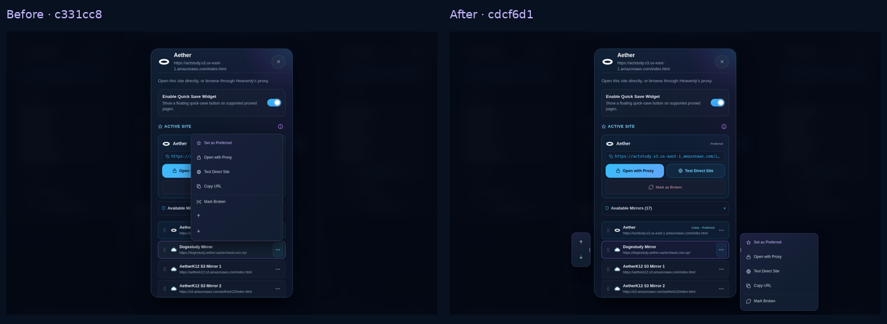
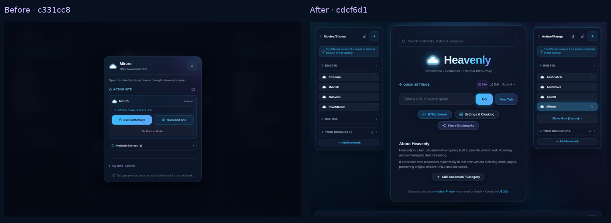
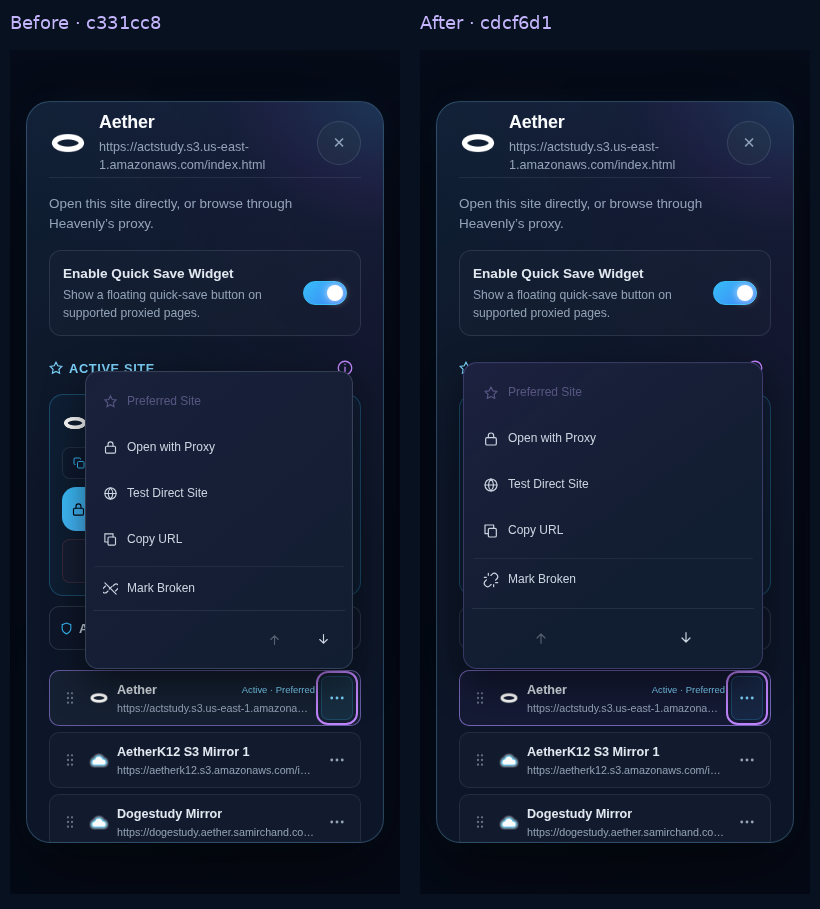
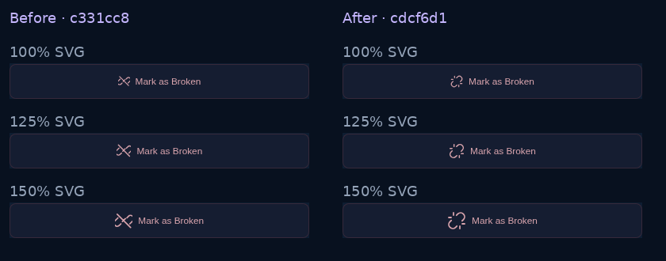

# Desktop drag recovery and dual slide-out mirror panels

Continues PR #186 on `feat/mirror-management-v2`. Implementation: `cdcf6d1`. The comparison baseline is the preceding PR head, `c331cc8`.

## Reproduced desktop failure

Basic native drops passed locally, but a **650 ms mouse hold followed by movement** reproduced a different failure: the bookmark body timer reset its launch preference and opened the launch dialog before pickup. The native drag could then overlap the dialog and fail to commit. This was reproduced both locally and on the previous authenticated Vercel deployment. The prior capturing-listener cleanup fix did not address this path.

Native anchor dragging also ends the pointer stream with `pointercancel`, leaving native and custom handlers to coordinate ownership, preview, release and cleanup. We considered further native-event patches and one captured mouse-pointer path. The latter removes that browser handoff while retaining the existing placement and persistence helpers.

Modern browsers now use a six-pixel mouse movement threshold for both grips and noninteractive bookmark/category surfaces. The nearest bookmark wins over its containing category. Interactive controls are excluded. Pickup captures the pointer and cancels pending holds; release resolves the destination again, saves it, and clears capture, preview, dimming, cursor and insertion space. Escape, lost capture, blur, hidden documents, rerender and invalid release cancel safely. Fresh clicks work immediately afterward. Real mouse input is also distinguished from touch compatibility events when Firefox omits `sourceCapabilities`.

**Stationary desktop holds retain their existing reset/open action on release.** Moving into a drag never commits that hold action. Touch keeps its immediate long-press action while held and native body scrolling. Touch and pen grips retain their existing deliberate movement/cancellation behavior. Native dragging remains a fallback for browsers without Pointer Events.

## Two outside panels and one compact sheet

The desktop interface consists of **two separate top-layer surfaces**: a 60 px movement rail beyond the dialog's left edge and a 248 px action surface beyond its right edge. The selected mirror supplies their vertical reference and remains highlighted. Subtle inner-edge markers connect the surfaces visually to that row.

The rail slides left and the commands slide right over 210 ms, with a 165 ms reverse exit. Closing surfaces become inert immediately. Animation completion owns cleanup, with cancellation guards and a suspended-renderer fallback. Reopening and changing rows cannot leave stale controls.

Layout selection measures both outer spaces around the actual dialog against the visual viewport. Portrait, landscape, off-center dialogs, resize and viewport changes are covered; a fixed breakpoint does not decide the layout. Insufficient space yields one bounded, scrollable action sheet. Its Up/Down buttons occupy equal columns with matched 44 px targets, accessible mirror-specific names, tooltips and disabled boundary states.

The Popover API escapes list clipping while preserving DOM ownership. Without it, the surfaces temporarily move into the parent modal and return to their original positions on close. They participate in the parent's Tab loop. Escape dismisses the panels and restores their trigger even when focus is elsewhere in the dialog. Outside interaction, parent closure, reordering, removal and scrolling the row out of view also dismiss or update them.

Active Site keeps its copyable URL, launch buttons and confirmed full-width broken-link control. Its contextual menu does not regain duplicate Copy/Mark Broken commands. Preferred/active/order metadata, canonical URLs, custom mirrors, restoration and event-specific promotion remain covered.

## Drag motion and icon correction

The shared metadata preview retains the actual icon and name with purple bookmark/mirror accents and cyan category accents. The 150 ms pickup adds restrained lift and depth; coordinates follow animation frames without easing. Existing neighboring displacement, geometric placement, FLIP movement and 160 ms settling remain in use. Reduced motion skips these effects.

The previous broken-link path extended beyond its 24 × 24 viewBox. The replacement uses an inset Lucide-style unlink drawing, round caps/joins, fixed flex sizing and complete stroke bounds. Actual Chromium, Firefox and WebKit captures verify 100%, 125% and 150% SVG render scales; the first confirmation activation still writes nothing.

## Actual comparisons

All images below render directly on GitHub and link to their image files.

[](assets/premium-ux/dual-panels.png)

[](assets/premium-ux/delayed-pickup.png)

[](assets/premium-ux/compact-sheet.png)

[](assets/premium-ux/broken-icon.png)

The separately delivered self-contained **comparison.html embeds 46 actual PNG captures**. Every image decodes and opens at its original pixel width; desktop and 390 px viewing/dismissal were checked in Chromium. Revision, engine, viewport, state and simulation are labeled. Opening/closing samples explicitly pause the real Web Animations at 90/80 ms for capture. The report needs no sidecar image folder. A Chromium mouse-interaction trace is also available with the delivered artifacts.

Reproduce visual captures with Playwright available:

```sh
HEAVENLY_REFERENCE_ROOT=/path/to/c331cc8-checkout node test/browser/capture_premium_interactions.cjs before work/comparison/before
node test/browser/capture_premium_interactions.cjs after work/comparison/after
node scripts/build-ui-comparison.cjs manifest.json comparison.html
node test/browser/ui_comparison_report.cjs /absolute/path/to/comparison.html
```

The report manifest format is documented in [the preceding refinement](final-ux-refinement.md#actual-image-comparisons).

## Verification

**427 unit tests pass.** Inline scripts, changed helpers and browser scripts parse; whitespace checks pass. No production dependency or drag library was added.

| Browser suite | Chromium | Firefox | WebKit |
| --- | ---: | ---: | ---: |
| Extended final UX refinement | 17 | 17 | 17 |
| UI recovery | 14 | — | — |
| Mirror V2, real promotion timers and Return Home | 9 | — | — |
| Mirror ordering / emulated touch and pen / legacy URLs | 7 | — | — |
| Bookmark management | 13 | — | — |
| Gesture conflicts and stationary desktop holds | 9 | — | — |
| Adaptive dragging | 7 | — | — |
| Bookmark notes / backup | 6 | — | — |
| Bookmark follow-up / sharing | 8 | — | — |
| Bookmark experience | 7 | — | — |
| Quick Settings customization | 23 | — | — |
| Navigation / history | 15 | — | — |
| Self-contained report | 2 | — | — |

**171 browser check groups** completed for this refinement. The mouse matrix uses actual rendered handles, titles, icons, card padding and category surfaces, intermediate movement, release and saved-order assertions. It covers cross-category/scrolled drops, delayed pickup, cancellation, immediate clicks, repeated attempts and cleanup. The extended suite also tests genuinely external bounds, measured compact fallback, equal arrows, both portal surfaces, parent focus traversal, confirmation, SVG bounds, retained accordions and reduced motion.

```sh
node test/browser/final_ux_refinement.cjs
HEAVENLY_BROWSER=firefox node test/browser/final_ux_refinement.cjs
HEAVENLY_BROWSER=webkit node test/browser/final_ux_refinement.cjs
npm test
```

Optional `HEAVENLY_BROWSER_EXECUTABLE` selects an engine launcher. Tests wait for loading, entrance/accordion motion and stable layout before measuring targets; they do not mistake transient animation geometry for a placement result.

Viewports include 1366 × 900 desktop, 1366 × 768 Chromebook-sized, 1180 × 820 iPad landscape-sized, 820 × 1180 portrait-sized and 390 × 844 narrow layouts; the V2 regression also checks 320 px. These are simulated viewports/inputs. Physical Chromebook, iPad Safari and pen hardware, Brave-specific behavior and operating-system/browser-toolbar zoom were unavailable. SVG scaling and viewport fitting were verified independently. Controlled external responses/icons establish UI behavior, not endpoint health. Return Home remains subject to browser focus/opener policy. No destination crawl, RiveStream investigation, TLS weakening or proxy-validation change was performed.
